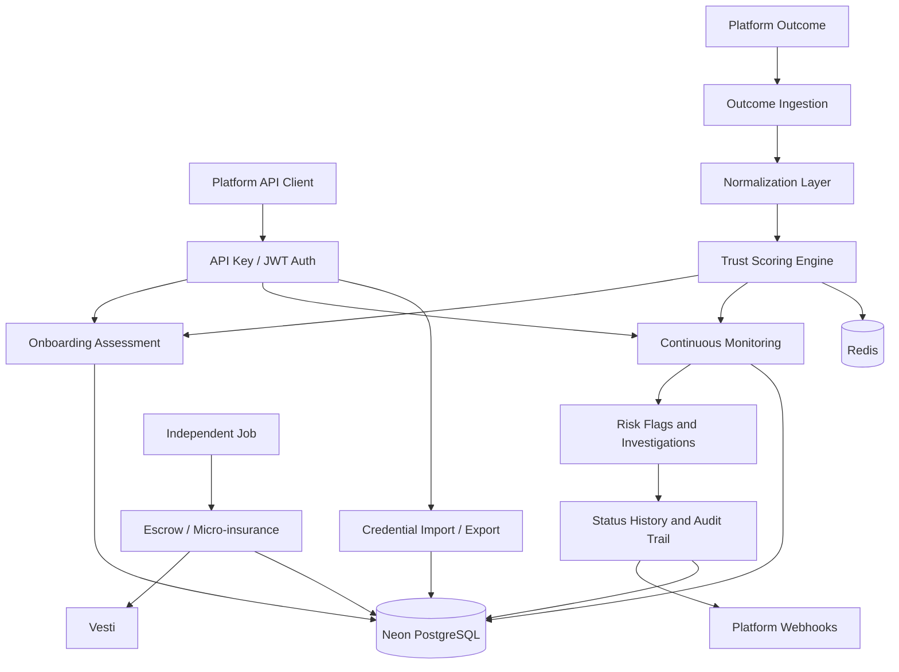
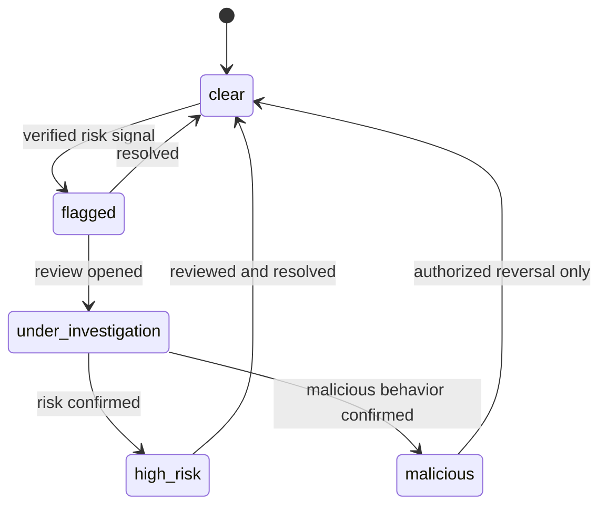

# Dynamic Trust Infrastructure Architecture

## Product scope

The B2B Platform API has three primary responsibilities:

1. **Onboarding assessment**: determine whether a worker can offer a service using a decision, confidence, trust band, normalized history, optional guarantor, and imported credentials.
2. **Continuous monitoring**: track current standing after onboarding, including risk flags, investigation state, malicious/high-risk markers, and historical status transitions.
3. **Portable credentials**: export and import verified work history and trust records so workers do not restart with no history on every platform.

Normalization, configurable policies, outcome ingestion, guarantors, audit events, and independent-job escrow support these three responsibilities.

## Runtime topology

```text
Next.js frontend :3000
        |
FastAPI backend :8000
     /       \
Neon         Redis :6379
PostgreSQL   local Docker service
(shared)
```

Neon PostgreSQL is the shared source of truth from the first scaffold. The local Compose stack intentionally contains Redis only. This keeps team members aligned on schema and migration behavior while retaining a disposable local cache and rate-limiting dependency.

## Runtime request flow



## Monitoring state model



Every transition writes a status-history record and an audit event. Current status is a projection; history is the source for investigation and compliance review.

## Boundaries

- API routes handle HTTP validation and dependency injection.
- Services own trust, normalization, credential, guarantor, job, and escrow business logic.
- SQLAlchemy models own persistence mapping.
- Pydantic schemas own request and response contracts.
- External identity and escrow providers remain integrations, not core domain models.
- Monitoring owns risk status, flags, investigations, subscriptions, and status history.
- Credential portability owns signed export/import records and validation, not raw provider secrets.

## Initial vertical slice

The first product slice should be onboarding assessment plus normalized outcome ingestion. Continuous monitoring then consumes new outcomes and assessment events to update risk status and notify platforms. Guarantors, credentials, and independent-job escrow remain supporting flows.

## Database discipline

Use `DATABASE_URL` from the environment. Runtime connections should use SQLAlchemy's async PostgreSQL driver and Neon-compatible SSL settings. Alembic migrations are the shared schema contract and should be applied deliberately against the team Neon project.
