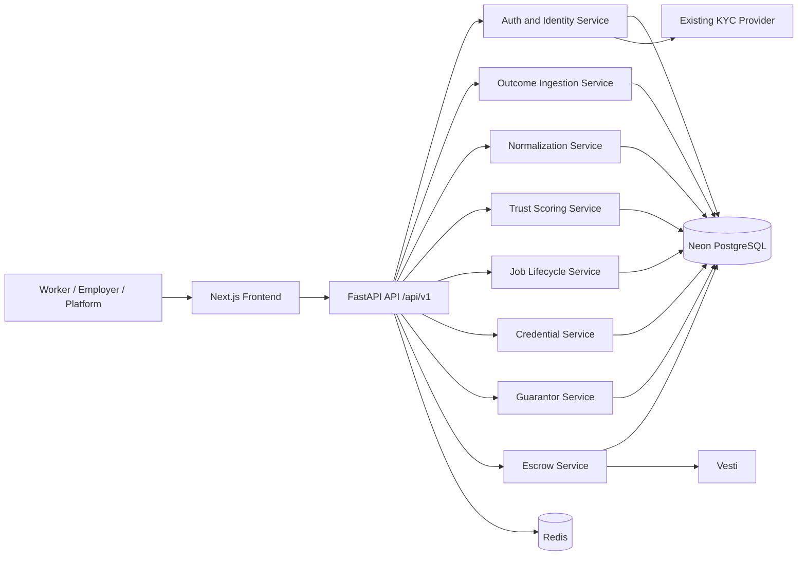
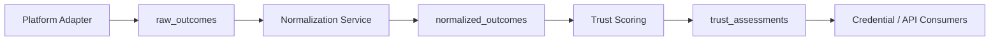
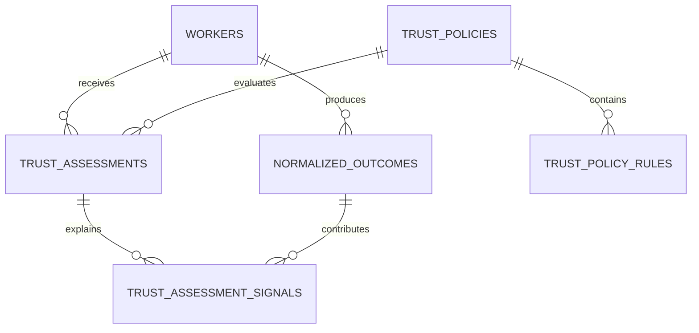
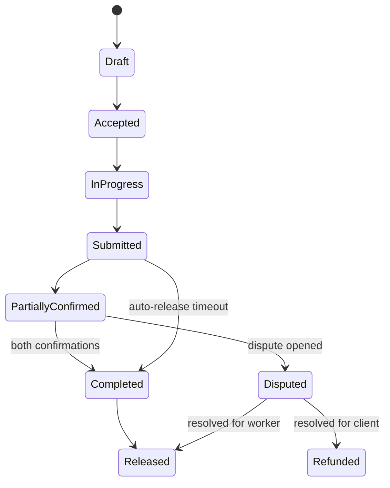
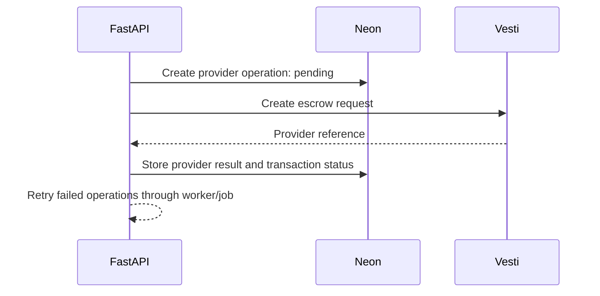
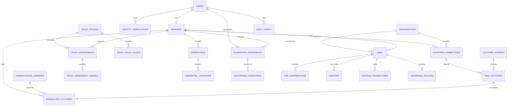

The existing scaffold already establishes the right split: Neon is the shared source of truth, Redis is ephemeral infrastructure, and FastAPI services own domain behavior. Included auditable state transitions and raw-to-normalized outcome lineage, with escrow isolated to independent jobs.


# Database Design and Architecture

## Recommended topology

Neon PostgreSQL is the shared system of record. Redis remains local Docker infrastructure for caching, rate limiting, and short-lived workflow coordination.



Keep this as a modular monolith initially. Separate services logically in FastAPI, but do not introduce microservices during the MVP.

---

## Main database domains

### Identity and organizations

| Table                      | Purpose                                    |
| -------------------------- | ------------------------------------------ |
| `users`                  | Authenticated human accounts               |
| `workers`                | Worker-specific profile and history status |
| `organizations`          | Employers, platforms, or operators         |
| `platform_connections`   | External platform account references       |
| `identity_verifications` | KYC provider references and statuses       |

Important rules:

- A guarantor must reference a real verified `user`.
- Store KYC references, not identity documents.
- Store external account IDs, not provider credentials.
- Use `user_id` as the one-to-one key between `users` and `workers`.

### Outcome ingestion and normalization

| Table                      | Purpose                               |
| -------------------------- | ------------------------------------- |
| `outcome_sources`        | Defines an external platform/provider |
| `normalization_versions` | Versioned transformation rules        |
| `raw_outcomes`           | Immutable original provider payload   |
| `normalized_outcomes`    | Canonical outcome used by scoring     |

The data flow should be:



`raw_outcomes` preserves lineage. `normalized_outcomes` is the only outcome representation the scoring engine should consume.

Recommended idempotency constraint:

```text
UNIQUE(source_id, external_outcome_id)
```

Prevents duplicate ingestion when a platform retries a webhook or import.

---

## Trust scoring model

| Table                        | Purpose                                                                                                                                                                             |
| ---------------------------- | ----------------------------------------------------------------------------------------------------------------------------------------------------------------------------------- |
| `trust_policies`           | Named scoring policy and version, Configuration belonging to a platform or platform type (e.g. “Domestic”, “Handyman”). Contains the rules for how trust should be calculated. |
| `trust_policy_rules`       | Weighted rules within a policy, The individual rules inside a policy (weights, thresholds, minimum jobs required, decision cut-off, etc.).                                         |
| `trust_assessments`        | Immutable scoring result, The actual trust result for a worker (decision: true/false, confidence score, band: High/Medium/Low/Building History).                                   |
| `trust_assessment_signals` | Explainable inputs used in an assessment,The breakdown of why a particular assessment was given — which signals contributed and how much.                                          |

A trust assessment should contain:

- `worker_id`
- `policy_id`
- `policy_version`
- `decision`
- `confidence`
- `status`
- `input_fingerprint`
- `assessed_at`

Suggested statuses:

```text
building_history
approved
restricted
review_required
```

Do not store only the latest score on `workers`. Assessments should be append-only snapshots, with the latest result selected through a query or Redis cache.

Confidence should use a database constraint:

```text
0 <= confidence <= 1
```

Example relationship:




1. **WORKERS → NORMALIZED_OUTCOMES** (produces)
   One worker can have many normalised job outcomes. These are the raw material for scoring.
2. **WORKERS → TRUST_ASSESSMENTS** (receives)
   One worker can receive many trust assessments over time (or for different platforms/policies).
3. **TRUST_POLICIES → TRUST_POLICY_RULES** (contains)
   One policy contains many rules (the weights and thresholds that define how scoring works for that platform type).
4. **TRUST_POLICIES → TRUST_ASSESSMENTS** (evaluates)
   A policy is used to evaluate and produce trust assessments.
5. **TRUST_ASSESSMENTS → TRUST_ASSESSMENT_SIGNALS** (explains)
   Each assessment is explained by multiple signals (e.g. “completion_rate contributed 0.28”, “dispute_rate contributed 0.22”).
6. **NORMALIZED_OUTCOMES → TRUST_ASSESSMENT_SIGNALS** (contributes)
   The normalised outcomes are the source data that feed into the signals used in an assessment.

Worker does jobs
      ↓
Jobs become NORMALIZED_OUTCOMES
      ↓
A TRUST_POLICY (with its RULES) is applied
      ↓
System creates a TRUST_ASSESSMENT
      ↓
The assessment is broken down into TRUST_ASSESSMENT_SIGNALS
(for explainability)


### Why this design is good

* **Configurable** : Different platforms can have different TRUST_POLICIES and TRUST_POLICY_RULES.
* **Explainable** : Every score can be traced back to specific signals.
* **Normalised** : Raw platform data is cleaned into NORMALIZED_OUTCOMES before scoring.
* **Historical** : A worker can have many assessments over time.
* **Auditable** : You can see exactly which outcomes contributed to a given score.


---


## Portable credentials

| Table                    | Purpose                                          |
| ------------------------ | ------------------------------------------------ |
| `credentials`          | Credential metadata and signed content reference |
| `credential_transfers` | Import/export history and validation results     |

A credential should include:

- subject worker
- issuer
- credential type
- version
- status
- issued timestamp
- expiration timestamp
- signed payload hash
- revocation timestamp, if applicable

The database should not need to understand every credential payload. We store the signed payload or object reference, plus indexed metadata required for validation and lookup.

---

## Guarantor and electronic signatures

| Table                     | Purpose                               |
| ------------------------- | ------------------------------------- |
| `guarantor_agreements`  | Guarantor relationship and lifecycle  |
| `electronic_signatures` | Signature evidence and audit metadata |

Suggested guarantor states:

```text
requested
pending_signature
active
suspended
revoked
expired
declined
```

Every signature must record:

- signer user ID
- signer identity reference
- timestamp
- IP address
- user-agent
- signature hash
- agreement ID

A guarantor agreement should reference both:

```text
worker_id
guarantor_user_id
```

The `guarantor_user_id` must point to a human `users` record, never an organization.

---

## Jobs, confirmation, and disputes

| Table                 | Purpose                           |
| --------------------- | --------------------------------- |
| `jobs`              | Work agreement and lifecycle      |
| `job_confirmations` | Confirmation from each party      |
| `disputes`          | Dispute case and resolution state |
| `audit_events`      | Append-only domain history        |

Suggested job states:

```text
draft
accepted
in_progress
submitted
partially_confirmed
completed
disputed
cancelled
released
```

`job_confirmations` should enforce:

```text
UNIQUE(job_id, confirmer_role)
```

Example roles:

```text
worker
client
platform
```

Completion flow:



Row-level locking when accepting confirmations or changing job state so two simultaneous requests cannot release the same job twice.

---

## Escrow and micro-insurance

| Table                   | Purpose                                           |
| ----------------------- | ------------------------------------------------- |
| `escrow_transactions` | Vesti hold, release, refund, or dispute operation |
| `insurance_policies`  | Optional independent-job coverage                 |
| `provider_operations` | Retryable external provider calls                 |

Escrow must only be available for platform-independent jobs.

The safest design is:

```text
jobs.job_type = independent
jobs.escrow_eligible = true
```

`escrow_transactions` references `job_id`. The service layer must reject transactions for platform-backed jobs. A PostgreSQL trigger that prevents escrow rows when the referenced job is not independent should be integrated. 

An open DB connection while calling Vesti should not be used. We follow the sequence below:



---

## Recommended ERD



---

## Important PostgreSQL conventions

Use:

- UUID primary keys
- `timestamptz` in UTC
- `numeric(12, 2)` for money
- PostgreSQL enums or constrained strings for workflow states
- JSONB only for provider payloads and flexible configuration
- foreign keys with explicit delete behavior
- immutable audit and raw-ingestion records
- Alembic migrations as the shared schema contract

Recommended indexes:

```text
normalized_outcomes(worker_id, occurred_at DESC)
trust_assessments(worker_id, assessed_at DESC)
raw_outcomes(source_id, external_outcome_id)
jobs(worker_id, status)
jobs(organization_id, status)
job_confirmations(job_id, confirmer_role)
disputes(status, created_at DESC)
audit_events(entity_type, entity_id, created_at DESC)
```

Use partial indexes for:

```text
active trust assessments
pending disputes
jobs awaiting confirmation
active guarantor agreements
```

---

## Transaction boundaries

### Outcome ingestion

One transaction should:

1. Insert raw outcome if not already present.
2. Create normalized outcome.
3. Record normalization version.
4. Mark worker trust cache as stale.

### Trust assessment

One transaction should:

1. Load active policy.
2. Load normalized worker outcomes.
3. Calculate decision and confidence.
4. Insert assessment.
5. Insert explainable signals.
6. Invalidate the worker trust cache.

### Job confirmation

One transaction should:

1. Lock the job row.
2. Insert or update the party confirmation.
3. Recalculate job state.
4. Create release or dispute intent.
5. Write an audit event.

### External providers

Use a `provider_operations` table for:

- KYC verification requests
- Vesti escrow holds
- Vesti releases
- refunds
- insurance operations

This gives the system retries, idempotency, and traceability without coupling external network calls to database transactions.

---

## Implementation order

1. SQLAlchemy base, naming conventions, common timestamps, and UUID utilities
2. Identity and organization models
3. Outcome source, raw outcome, normalization version, and normalized outcome models
4. Trust policy, assessment, and signal models
5. Job, confirmation, dispute, and audit models
6. Escrow, insurance, and provider-operation models
7. Credential and guarantor models
8. Alembic migrations and seed policy
9. Repository/service tests for constraints and state transitions
